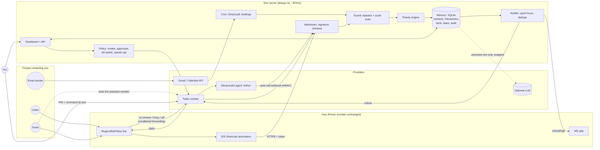

# Architecture

## Choice and why

**One small always-on server running one Python app with one SQLite file.** No Redis, no n8n, no
Kubernetes. Fewer moving parts means fewer 3 a.m. failures and almost no cost.

| Considered | Decision | Reason |
|---|---|---|
| ElevenLabs Agents | **Use** | You already pay for it, Arthur is built, it handles real-time voice, and it already talks to your Twilio numbers. |
| Twilio | **Use** | Already set up; Canadian numbers; SMS for alerts. |
| FastAPI | **Use** | Small, fast, easy to test. |
| SQLite (WAL) + FTS5 | **Use now** | Zero admin, single file, easy encrypted backup. Fine for one person's lifetime of messages. |
| PostgreSQL + pgvector | **Later** | Switch when you want semantic ("meaning") search across years of history. The schema is portable. |
| Redis | Skip | No queue volume that needs it. |
| n8n | Skip | Adds a second system to secure and maintain. Cron + this app covers the schedules. |
| Docker + Caddy | **Use for deploy** | One command to run, automatic HTTPS. |
| Tailscale | **Use for the room speaker and laptop** | Lets home devices reach the server privately without opening ports. |
| Home Assistant | **Phase 6** | Best path for the room speaker, wake word and presence. |
| Hermes | **Keep on laptop** | Not 24/7. It can read/write the central memory through the HTTP API. |
| OpenAI / Anthropic API | **Optional** | Only improves summary wording. All decisions are rules + policy, so an LLM mistake can't send anything. |

## Diagram

## Data flow for one call

1. Caller rings your cell. You don't answer, so the carrier forwards to the Twilio number.
2. Arthur answers, says he is your AI assistant and that the call is recorded, collects name, number, reason, urgency, callback time.
3. Call ends. ElevenLabs POSTs the transcript + collected fields to `/webhooks/elevenlabs/post-call`, signed.
4. Server checks the signature, scans only the caller's words for manipulation or scams, finds or creates the contact, pulls their last 3 interactions, scores urgency, writes a summary, stores everything, records the callback number as an **unverified** fact, flags it if it contradicts what's on file, and creates "Call back X" plus any deadlines mentioned.
5. Notifier routes by urgency: critical goes to push + text right away (even during quiet hours), high goes to push (held until morning during quiet hours), normal waits for the briefing, low is archived.
6. Anything the assistant wants to send back goes into the approval queue unless the mode and policy allow it.

## Memory model
- **interactions**: every call/text/email, raw text kept as untrusted data, summary, priority and the reason for it.
- **memories**: one row per fact with subject + attribute (e.g. `contact:12 / callback_number`), source, confidence, verified flag, status (active / disputed / superseded). A new value that disagrees with an old one marks both **disputed** and shows up in your briefing to confirm. A value you confirm wins.
- **tasks**: follow-ups, deadlines, commitments (owed by you or by them).
- **alerts**, **actions** (approval queue), **audit_log** (append-only), **spend**.

## Upgrade path to semantic memory
Move to PostgreSQL, add `pgvector`, store an embedding per interaction summary and per fact, and
search by similarity plus the existing keyword search. Do it once you have a few months of data.
